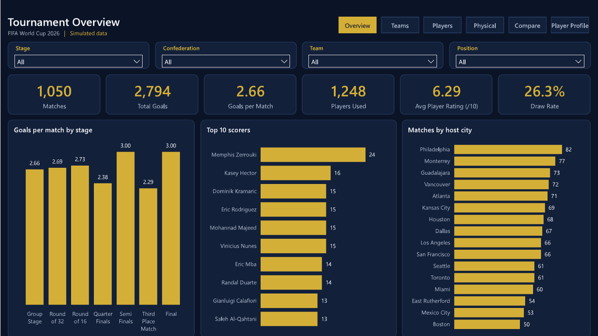
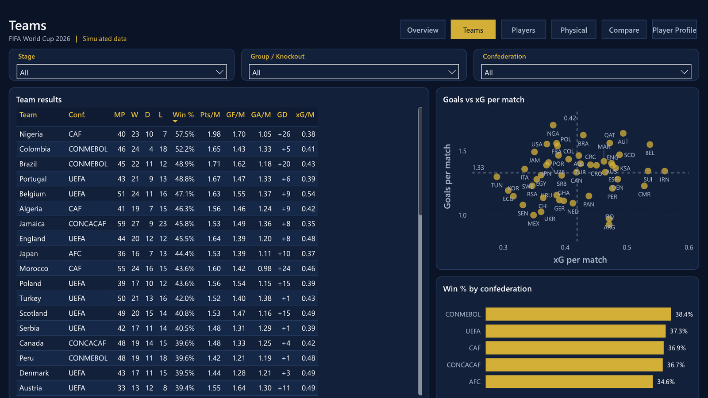
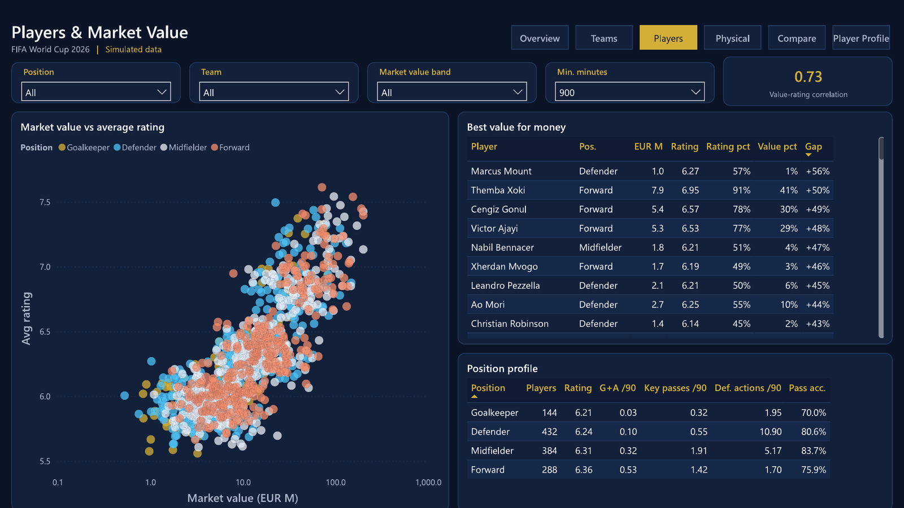
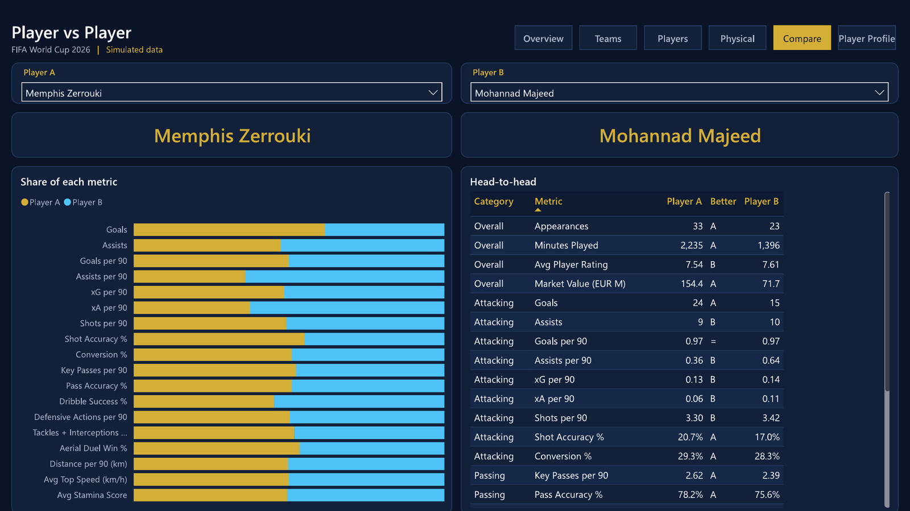
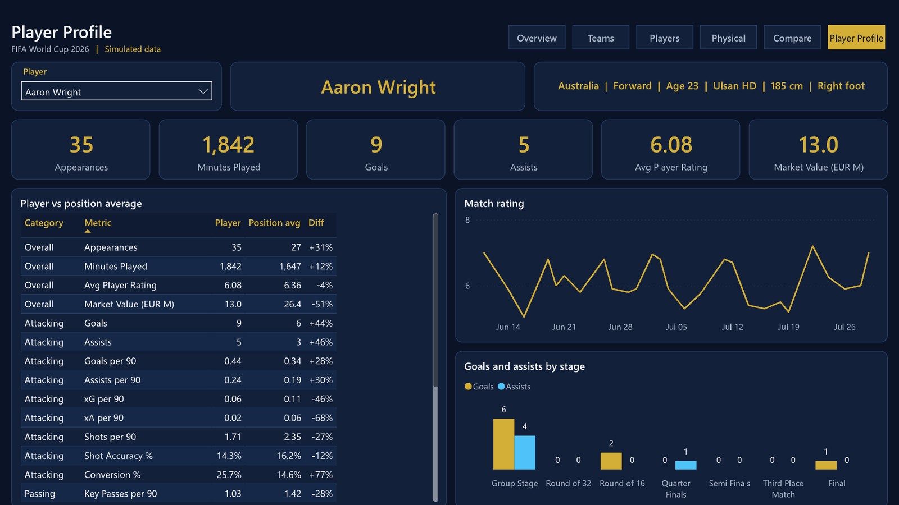
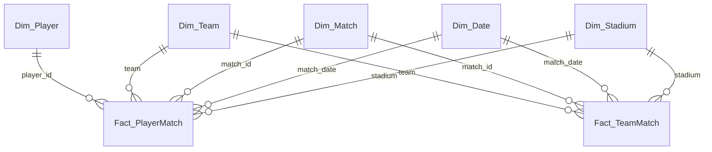

# FIFA World Cup 2026 – Player & Team Performance (Power BI)

An interactive Power BI report that analyses **54,600 player-match records** from a FIFA World Cup 2026 dataset: tournament trends, team results, player value-for-money, physical output and head-to-head player comparison.

> **Simulated data.** The dataset is synthetic (1,050 matches instead of the real tournament's 104, generated player names). The project demonstrates data modelling, DAX and report design; the numbers are not real FIFA results.



---

## Business questions and answers

| # | Question | Answer from the data |
|---|---|---|
| 1 | How many goals per match, and does it change by stage? | **2.66 goals per match** over 1,050 matches (2,794 goals). Stages range from 2.29 (third-place match) to 3.00 (semi-finals and final), but the knockout stages have very few matches (21 finals vs 578 group games), so the differences are not meaningful. |
| 2 | Which teams perform best? | **Nigeria** has the highest win rate (57.5%, 23 wins in 40 matches) and the best goal difference (+26). **Morocco** concedes the fewest goals per match (0.98). Win rate by confederation is very close (34.6%–38.4%), so no confederation dominates. |
| 3 | Who are the best scorers? | **Memphis Zerrouki** (Netherlands) leads with 24 goals; Mohannad Majeed (Iraq) matches his rate with 0.97 goals per 90 in fewer minutes. |
| 4 | Is the most expensive player the best? | **Largely yes.** The correlation between market value and average rating is **r = 0.73** (players with 900+ minutes). The interesting cases are the exceptions: **Marcus Mount** (England, defender, €1.0M) out-rates 57% of qualified players, and **Themba Xoki** (South Africa, €7.9M) is in the 91st rating percentile. |
| 5 | How do positions differ? | Forwards have the highest rating (6.36) and goal contributions (0.53 per 90). Midfielders cover the most ground (10.8 km per 90) and pass most accurately (83.7%). Defenders make 10.9 defensive actions per 90. |
| 6 | Does physical performance drop with age? | **No.** Stamina is almost flat: 87.4 for players aged 21 and under vs 86.8 for 34+. Top speed is identical for all outfield positions (32.5 km/h). |

---

## Report pages

| Page | Content |
|---|---|
| **Overview** | KPI cards, goals per match by stage, top 10 scorers, matches by host city |
| **Teams** | Team results table (rates per match), goals vs xG scatter with average lines, win % by confederation |
| **Players** | Market value vs rating scatter (log scale, by position), *best value for money* table, position profile, minimum-minutes slicer |
| **Physical** | Distance, sprint distance, top speed, stamina by position and age |
| **Compare** | Pick any two players: share of 18 performance metrics and a 24-metric head-to-head table |
| **Player Profile** | Searchable player selector, player card, player vs position average, rating over time |

| | |
|---|---|
|  |  |
|  |  |

---

## Data model

Star schema built in Power Query from a single 75-column CSV:



| Table | Rows | Grain / purpose |
|---|---|---|
| `Fact_PlayerMatch` | 54,600 | One player in one match – all player measures |
| `Fact_TeamMatch` | 2,100 | One team in one match – official score, result, points, team xG (built with a self-join for opponent xG) |
| `Dim_Player` | 1,248 | Age, position, club, market value, age group, value band |
| `Dim_Team` | 48 | FIFA code and confederation |
| `Dim_Match` | 1,050 | Stage with sort order, fixture, score label |
| `Dim_Stadium` | 16 | City, country, coordinates |
| `Dim_Date` | 61 | Marked date table (June–July 2026) |
| Helper tables | – | Disconnected player lists for the comparison page, metric list, minimum-minutes parameter |

Design choices:
- **Two fact tables** because results live at team-match grain; deriving them from the player table would repeat each score 26 times.
- **No relationship between `Dim_Team` and `Dim_Player`** to avoid an ambiguous filter path.
- **The CSV path is a parameter** (`CsvFilePath`), so the project runs on any machine after changing one value.
- **Auto date/time disabled**, all fact columns hidden: users work only with measures.

---

## DAX highlights

101 measures in a dedicated `_Measures` table, organised in display folders (Tournament, Teams, Players, Goalkeeping, Per 90, Physical, Value, Comparison).

**Value for money – rating percentile vs value percentile** (`Bargain Gap = [Rating Percentile] - [Value Percentile]`):

```DAX
Rating Percentile =
VAR MinMins = [Min Minutes Value]
VAR CurrentValue = [Avg Player Rating]
VAR Pool =
    CALCULATETABLE (
        FILTER (
            ADDCOLUMNS ( VALUES ( Dim_Player[player_id] ),
                "@Value", [Avg Player Rating], "@Minutes", [Minutes Played] ),
            [@Minutes] >= MinMins && [@Minutes] > 0
        ),
        ALLSELECTED ( Dim_Player )
    )
VAR PoolSize = COUNTROWS ( Pool )
VAR Below = COUNTROWS ( FILTER ( Pool, [@Value] < CurrentValue ) )
RETURN
    IF ( HASONEVALUE ( Dim_Player[player_id] ) && [Is Qualified] = 1 && PoolSize > 1,
         DIVIDE ( Below, PoolSize - 1 ) )
```

**Pearson correlation written in DAX:**

```DAX
Value vs Rating Correlation =
VAR Players =
    FILTER (
        ADDCOLUMNS ( VALUES ( Fact_PlayerMatch[player_id] ),
            "@x", [Market Value (EUR M)], "@y", [Avg Player Rating], "@m", [Minutes Played] ),
        [@m] >= [Min Minutes Value] && [@m] > 0 && NOT ISBLANK ( [@y] )
    )
VAR MeanX = AVERAGEX ( Players, [@x] )
VAR MeanY = AVERAGEX ( Players, [@y] )
VAR Covariance = SUMX ( Players, ( [@x] - MeanX ) * ( [@y] - MeanY ) )
VAR VarianceX = SUMX ( Players, ( [@x] - MeanX ) ^ 2 )
VAR VarianceY = SUMX ( Players, ( [@y] - MeanY ) ^ 2 )
RETURN
    IF ( COUNTROWS ( Players ) > 2, DIVIDE ( Covariance, SQRT ( VarianceX * VarianceY ) ) )
```

**Two independent player selections on one page** (disconnected tables + `TREATAS`), with a **dynamic format string** so percentages and counts display correctly from one measure:

```DAX
Player A Value =
IF (
    HASONEVALUE ( Compare_Player_A[player_id] ),
    CALCULATE (
        [Metric Value],
        REMOVEFILTERS ( Dim_Player ),
        REMOVEFILTERS ( Dim_Team ),
        TREATAS ( VALUES ( Compare_Player_A[player_id] ), Dim_Player[player_id] )
    )
)
-- Format string expression: SELECTEDVALUE ( Comparison_Metrics[Format], "0.00" )
```

---

## Data quality findings

Profiling the raw file found problems that would have produced wrong numbers if the columns were used as-is. Full details in [DATA_QUALITY.md](DATA_QUALITY.md).

| Issue | Decision |
|---|---|
| 42% of rows are unused substitutes (0 minutes, rating 0) | Averages and appearances count only players who played |
| Team score ≠ sum of player goals (match in only 27% of team-matches) | Team/tournament goals from the match score; player goals from player rows |
| `pass_accuracy` and `save_percentage` disagree with their own components | Recalculated in DAX from passes / saves |
| `total_*_tournament`, `player_of_match_awards` not constant per player | Excluded |
| xG is about 3× lower than actual goals | xG used only for relative comparison |
| Teams played 33–66 matches | Teams compared with per-match rates |

---

## Quality assurance

Every number shown in the report screenshots (**97 checks**: KPIs, team table rows, top scorers, best-value table, position profile, physical metrics, a full player comparison and a player profile) was recalculated independently in Python (pandas) and matched the DAX result exactly. See [qa/reconciliation.csv](qa/reconciliation.csv).

A companion Excel workbook, [FIFA_WC2026_Dashboard_Guide.xlsx](FIFA_WC2026_Dashboard_Guide.xlsx), documents every page and visual, all 101 DAX measures, the data model and the data-quality decisions, and recalculates the headline numbers and value-for-money percentiles with Excel formulas.

---

## How to open

1. Install a recent Power BI Desktop (2025 or later; the project uses the PBIP / PBIR format).
2. Download the dataset CSV (see *Data source*).
3. Open `FIFA_WC2026.pbip`.
4. **Transform data → Edit parameters → `CsvFilePath`**: paste the full path to the CSV.
5. Click **Refresh**.

## Repository structure

```
FIFA_WC2026.pbip                 Power BI project file (open this)
FIFA_WC2026.SemanticModel/       Model in TMDL: Power Query, relationships, 101 DAX measures
FIFA_WC2026.Report/              Report pages in PBIR + custom navy/gold theme
qa/reconciliation.csv            DAX vs Python reconciliation (97 checks)
qa/reconcile.py                  Script that recalculates every checked value
data_dictionary.md               Column-by-column profile of the source CSV
images/                          Page screenshots
DATA_QUALITY.md                  Data quality findings
client_guide/                    Client guide in Arabic (HTML + PDF)
FIFA_WC2026_Dashboard_Guide.xlsx Excel guide: pages, 101 measures, model, data quality, QA
```

## Data source

[FIFA World Cup 2026 Player Performance Dataset](https://www.kaggle.com/datasets/rauffauzanrambe/fifa-world-cup-2026-player-performance-dataset) on Kaggle (by rauffauzanrambe). The CSV is not included in this repository; download it from Kaggle.

## Tools and techniques

Power BI Desktop · Power Query (M) · Star schema modelling · DAX (percentiles, correlation, `TREATAS`, dynamic format strings, `TOPN` tie-breaking) · PBIP / TMDL / PBIR source control · Custom JSON theme · Python (pandas) for profiling and QA
